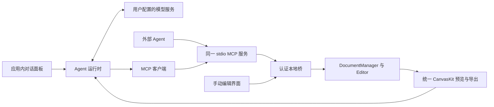

# Compositor Electron 第二版实施方案

日期：2026 年 10 月 9 日  
状态：AI 开发已开始，Windows 验证安排在功能完成后  
当前版本：0.2.0-alpha.1（开发试用版）  
目标版本：0.2.0  
实施目录：`/Users/zhoujin/Documents/PS/Compositor_Electron`

第二版的目标是：**在 macOS 和 Windows 上连续编辑多份工程，可靠保存，并在应用内通过对话让 Agent 对指定文档执行可预览、可停止、可撤销的图层编辑任务。** 界面和操作继续以本地原版 Compositor 1.4.7 为基准。

建议把 0.2.0 做成可日常试用的版本。先完成文档与保存、原版交互、批事务和内置对话，再把画笔、橡皮擦、选区与蒙版作为 0.2.x 的独立扩展。以下性能预算与尚未实现的接口为规划值；当前实现及验证结果见 [第二版开发记录](V2_IMPLEMENTATION_STATUS.md)。

**实施顺序按最新要求调整为：先补齐第二版功能，完成 Mac 上的功能验收，再进行 Windows 实机验证和平台修复。** Windows 设备、CI 和安装包不作为前面功能开发的启动条件。开发期间保持平台边界清晰，不在共享内核中加入 macOS 专属逻辑。

第二版功能完成与双平台验收完成分开记录。Mac 功能验收通过后可以交付 `0.2.0-alpha` 试用版；Windows 最后阶段通过后再交付 `0.2.0`，届时才能标记两端均已验证。

## 第一版基线

| 项目 | 第一版已有能力 | 第二版需要补齐的部分 |
| --- | --- | --- |
| 桌面应用 | Electron、Vue、CanvasKit；Mac arm64 应用已实际运行 | Windows x64 实机验收与平台问题修复 |
| 原版界面 | New canvas、工具列、变换栏、图层面板、状态栏 | 多标签、文档独立视图、图层多选和拖拽、像素命中 |
| 文档 | 单个 `Editor`，包含 session、revision、资源、历史 | 多文档管理、明确的目标文档、全应用资源预算 |
| 文件 | PNG/JPEG 导入、受支持的 `.comp` 子集、Save As、PNG 导出 | 原位 Save、关闭前保存、外部修改冲突、崩溃恢复 |
| 渲染 | CanvasKit CPU；画布、MCP 预览、PNG 导出共用实现 | 原版对照矩阵、组的合成语义、性能测量和缓存 |
| MCP | 五个真实工具；单动作事务、幂等、revision 校验、顶部撤销 | 原子批操作、任务记录、取消、整轮回退、多文档句柄 |
| Agent | 外部客户端可通过 MCP 操作；应用内仅有连接面板 | 真实模型对话、工具执行、操作前后预览、错误恢复 |
| 验证 | 16 项核心测试；Mac 桌面和打包版 MCP 结果为 PASS | 两端原生运行、恢复故障测试、真实模型任务验收 |

Windows 目前只有第一版在 Mac 上交叉构建的目录包。已有 GitHub Actions 配置，但尚未执行；两者不能替代 Windows 运行验收。第一版依据见 [第一阶段实施记录](V1_IMPLEMENTATION_STATUS.md)及 `artifacts/v1-baseline/`；当前协议见 [MCP 协议](MCP.md)。

## 第二版范围与优先级

| 优先级 | 功能 | 0.2.0 的交付标准 |
| --- | --- | --- |
| P0 | 多文档 | 新建、打开、切换、关闭；每份文档的历史、修改标记、缩放、平移和选择互相独立 |
| P0 | 保存与恢复 | Cmd/Ctrl+S 保存当前工程；另存为、保存副本各有明确行为；失败保留可恢复数据 |
| P0 | Agent 事务 | 一批动作全部成功或全部失败；任务绑定文档；重试、停止和任务回退有确定结果 |
| P0 | 内置对话 | 配置一个经过验收的模型提供方；模型看到实际 PNG，通过真实 MCP 编辑并检查结果 |
| P0 | 原版图像对照 | 对本版支持的混合、分组、变换、透明度进行样本验证，修复发现的语义差异 |
| P1 | 原版交互补齐 | 像素级 Auto Select、图层多选、同级排序拖拽、拖入文件夹；键盘和数值输入按原版核对 |
| P1 | 试用交付 | 正式项目图标、版本信息、两端完整目录包、校验值、验收报告与已知限制 |
| 最后阶段 | Windows 验收 | 功能稳定后，在 Windows x64 原生环境构建运行，修复系统差异并执行同一套核心与桌面测试 |

P0 和 P1 都属于 0.2.0 的计划范围，按小批次交付。功能阶段优先处理保存、事务和图像正确性；Windows 验收排在功能完成之后。Mac 试用包先交付，Windows 包随最后阶段交付。

0.2.0 的 Agent 主要执行已有图层能力：识别目标图层，移动、缩放、旋转、改变透明度与混合模式，复制、排序、分组、重命名、显隐和删除。它不能凭自然语言自动获得尚未实现的抠图、修复、文字排版或生成式填充能力。用户通过文件选择器或拖入方式提供素材，保存和导出沿用桌面入口。

## 产品操作与界面

### 连续编辑工程

顶部保留原版项目标签。打开或新建文档进入新标签，切换时恢复该文档的视图和选中图层；关闭标签只影响该文档。原版的导入行为应实际操作核对，区分欢迎页导入为新文档与已打开工程导入为图层，菜单名称清楚表达目的。

未保存标签显示修改标记。关闭有修改的文档提供保存、放弃修改、取消；保存失败或对话框取消时保留标签。应用退出逐份处理有修改的工程，避免只检查当前标签。

图层多选先支持 Shift 连续选择、Cmd/Ctrl 点选，以及批量显隐、删除、复制、移动和分组。同一次操作是一条历史记录；组与其后代同时被选中时先消除重复目标。批量复制先支持普通图层，文件夹整树复制另行扩展。多层移动使用共同位移，初期不加入多层整体旋转或复杂组变换。

Auto Select 按图层绘制顺序从上到下查找，对坐标做逆变换后检查源图 Alpha，并处理旋转、缩放、翻转、祖先显隐与有效透明度。命中阈值和快捷键通过原版体验确定。这里的像素命中不等于新增选区工具。

### 应用内 Agent 对话

沿用标题栏 Agent 入口，将当前连接抽屉扩展成可开关的对话面板；打开面板后画布重新 Fit，关闭后恢复视图。图层面板保留，窗口较窄时通过明确的面板切换使用空间。MCP 配置放到连接设置，聊天主界面呈现用户真正需要的信息：

- 当前任务绑定的文档、用户输入、模型答复和执行状态。
- 简洁的操作记录，例如“复制 Logo”“透明度 100% → 40%”，可以展开查看参数和错误。
- 操作前后实际画布缩略图、停止按钮、撤销本轮按钮。
- 模型配置状态、连接错误；提供方支持返回用量时显示用量，不推算未经校准的费用。

默认遵循用户发送的编辑指令执行可撤销操作，不对每个图层修改反复询问确认。任务期间用户可以继续手动编辑；Agent 遇到 revision 冲突后重新读状态和预览，不能把旧命令强行套到新状态。

切换标签不改变正在执行的任务目标。面板持续显示任务所属文档；关闭该文档先结束其任务。聊天记录按工作会话保存到应用数据目录，提供清除入口，不写入 `.comp`，恢复旧记录不自动恢复执行。

### 三个主要演示任务

1. “把 Logo 放到右上角，离画布边缘各 40 像素，缩放到宽 240 像素，并把透明度设为 80%。”Agent 读状态和预览、辨认 Logo、批量提交变换与透明度，再展示结果。
2. “把这三个装饰图层放进 Decorations 文件夹，保持现在的位置和顺序。”Agent 按 ID 操作；新文件夹 ID 可在同批后续动作中引用；整轮可撤销。
3. “复制主体图层，将副本右移 120 像素并改为 35% 透明度。”用户切换另一标签时，任务仍作用于原文档；撤销后恢复原始图像和图层数量。

目标辨认有歧义时，Agent 用图层名称和预览提出具体选择，不猜测并删除图层。任务成功必须以工具结果和实际输出为依据。

## 文档与保存实现

### 多文档权威状态

新增 `DocumentManager` 管理多个现有 `Editor`，继续由 utilityProcess 串行提交编辑。每份打开的文档保存独立 session、revision、历史、幂等记录、文件路径与任务信息。窗口的活动标签是独立的界面状态。

路由使用打开文档句柄 `sessionId`，同时校验工程内的 `documentId`。同一个 `.comp` 被打开两次可能有相同 documentId，不能只用 documentId 路由。关闭和重新打开必须使旧句柄失效；恢复工程也生成新 session。

将第一版全局 `interactionBusy` 改为按文档记录的交互租约，包含交互 ID、持有者与超时清理。旧标签释放交互状态时，不能误解锁另一个标签；renderer 异常退出也不能留下永久 busy。

多文档会放大内存需求。第一批先保留现有单文档限制，并增加全应用保留资源预算和解码缓存回收；预算同时计入当前内容、撤销、重做和进行中的预览。不能让每个标签各自获准分配 6400 万像素而导致总内存失控。打开超预算工程时说明原因，让用户关闭其他文档或主动清理历史。

初始全应用保留资源预算建议为 6400 万像素，内容相同的不可变资产按哈希去重统计；最多同时打开 8 个文档。解码、合成缓冲与缩略图仍需另计内存。预算在 M0 测量后定稿，不静默丢弃撤销历史换取打开成功。检查超预算或打开失败时，不创建半成品标签，不改变当前活动文档。

所有异步操作在发起时捕获 sessionId。文件对话框返回、资源读取完成和预览结果到达时，再确认目标仍存在。用户期间切换标签不得把导入、保存或导出转移到新标签。资源协议和隐藏预览窗口按 session 路由，主窗口仅更新对应标签的状态；旧会话事件直接丢弃。

### Save 与恢复

`.comp` 是包含多个文件的目录包。不能用“删除旧目录再写新目录”实现 Save，也不能承诺目录覆盖在两端是单步原子操作。建议采用可恢复的保存协议：

1. 锁定本次文档快照和保存目标，检查目标是否被其他编辑器修改。
2. 在同一文件系统的临时目录写出完整工程，检查资源哈希并回读验证；按平台能力同步关键文件。
3. 写入保存日志，记录目标、暂存、备份路径、阶段和内容指纹。
4. 保留旧包为备份，再将新包安装到目标路径；成功后更新 savedContent，最后清理日志和备份。
5. 应用启动时检查未完成日志，验证候选包，恢复到完整旧版或完整新版；不能仅依靠文件名判断有效性。

对跨卷目标使用目标卷上的暂存目录。Windows 文件占用和重命名失败时保留有效备份并报告错误；磁盘满、权限失败时保留文档修改标记。应用自己之间使用排他锁，同时以打开时的包内容指纹检测外部修改；第三方程序不遵守锁时，不能宣称具有完全并发写入保证。

未命名文档的 Save 打开路径选择；已有路径的 Save 更新该工程。Save As 切换文档关联路径，Save a Copy 保留原路径和原保存基线。清楚区分三种菜单和快捷键，按原版核对。

自动恢复副本保存在应用数据目录，按空闲延迟写入并限制容量，建议初始延迟 5 秒。恢复副本包含完整 manifest 与所需 PNG 资源，不覆盖用户原工程。启动提供恢复入口，恢复完成后保留“尚未保存”状态。任务记录中的旧句柄不可用于继续修改恢复文档。

保存协议要验收在各阶段强制退出后的可恢复性；这不构成所有磁盘硬件、网络盘和突然断电情况下的绝对无损承诺。

保存写入时捕获明确的 revision 和内容指纹。保存完成后只把该快照记为已保存；如果期间存在新的编辑，文档仍显示修改标记。取消保存对话框不改变 projectPath 或保存基线。PNG 导出同样锁定目标文档和快照，返回导出的 revision，避免导出按钮操作期间切换标签导致错图。

## MCP 与任务实现

### 协议演进

保留第一版五工具的受支持行为。`app.get_capabilities` 增加协议版本、批操作上限、文档句柄及任务能力。第一版空参数 `document.get_state` 仍可查询当前文档；新客户端显式传 sessionId。旧 preview 已携带 sessionId，多文档后按该句柄取快照。

| 拟新增或扩展的工具 | 用途 |
| --- | --- |
| `document.list` | 枚举已打开文档的名称、句柄、revision 和活动状态，减少错文档操作 |
| `document.get_state` | 显式查询目标 session；返回目标文档的图层、资源、历史与任务摘要 |
| `document.apply_batch` | 一批有类型的动作，在同一文档上原子提交，返回事务和新建对象映射 |
| `task.begin` | 建立绑定文档的 taskId，记录起始 revision 和任务描述 |
| `task.get_status` | 查询执行、提交、取消、失败及结果未知状态，获得已提交事务列表 |
| `task.cancel` | 请求停止后续工具调度与未提交工作；明确已经提交的结果 |
| `task.finish` | 将任务结束为 completed 或 failed，保留已提交事务 |
| `history.undo_task` | 撤销位于历史顶部且连续属于该任务的事务；出现后续人工操作时拒绝 |

上述名称和字段在契约批次中定稿，之后由 UI、外部 MCP 和内置运行时共用。这里的工具不开放任意文件路径、shell 或 JavaScript 执行。

### 原子批事务

初始每批最多 100 个动作，同时受现有 64 KiB 请求体与资源预算限制。先在工作副本上执行全部动作并校验层级、资源和引用，成功后一次性安装 manifest 与新增资产，revision 增加一次，历史增加一条。任一步失败都不能残留部分图层或资产。

新建文件夹、复制图层等动作支持批内 `clientRef`。后续动作通过该引用定位新对象，返回结果给出引用到真实 ID 的映射；Agent 无需靠“最新图层”猜测。批内引用只能指向之前创建的对象。

图层列表拖拽需要新增明确的移动动作，例如 `layer.move`，使用目标 parentId 与同级 beforeLayerId 表达位置，保留多选对象的相对顺序；不能仅依赖第一版 up/down 接口处理任意落点。层级循环、目标在被移动子树内及已消失的落点都在提交前拒绝。

继续要求 sessionId、documentId、expectedRevision 和 idempotencyKey。先查幂等结果再检查 revision，使响应丢失后的相同请求可返回原结果。相同 key 配不同参数继续拒绝；保留当前 session 内有限缓存的边界，不承诺重启后的 exactly-once。

### 停止和任务撤销

任务状态区分计划、执行、取消请求、已停止、完成、失败和结果待核对。取消停止下一步，不自动撤销已提交结果；用户可另行撤销本轮。短批提交不能从中间打断，取消和提交竞争时返回最终提交结果。长工作在提交前检查取消，取消信号不能排在该工作后面的同一串行队列中等待。

任务包含多批时，记录每批 transactionId。只有对应事务连续位于历史顶部时，任务撤销才能一次恢复最早的 before 状态；整个回退过程同样检查当前 revision，不穿过用户操作或其他任务。任务之间或人工修改插入后，提示回退冲突，让用户决定后续操作。

同一文档同一时刻仅有一个写入中的 Agent 任务；不同文档可分别运行，但所有提交仍经过权威服务。工具超时不是失败证明，运行时先查询 task 状态和 revision，再决定是否按原 key 重试。崩溃后的旧任务只作为记录，不自动继续执行。

### 契约验收用例

批请求至少包含以下字段，实际 Zod schema 在 M4 固定：

```json
{
  "sessionId": "目标打开实例的 UUID",
  "documentId": "工程 documentID",
  "expectedRevision": 12,
  "idempotencyKey": "本次提交唯一的 key",
  "taskId": "可选的 Agent 任务 UUID",
  "actions": [
    { "type": "group.add", "name": "Decorations", "clientRef": "newGroup" },
    { "type": "layer.set_parent", "layerId": "实际图层 UUID", "parentId": { "ref": "newGroup" } }
  ]
}
```

这是字段设计示意，示意字符串不可直接通过 UUID 校验。结果包含 previousRevision、revision、transactionId、创建对象映射、status 和 undoable；无内容变化不增加 revision，也不清空重做历史。新工具与错误码全部写入 `docs/MCP.md`，不让模型通过 UI 文案猜协议。

任务记录至少保存 taskId、目标 session、起始与最新 revision、状态、transactionId 列表和最后一次错误。任务回退后保留审计记录，并按原任务顺序支持人工重做；历史已被截断时返回明确错误。`task.begin` 同样要求幂等 key，避免开始任务的响应丢失后创建多个任务。

## 内置 Agent 运行时

新增 `src/agent/`，在受信任的主进程或独立 utilityProcess 中运行模型请求与工具循环。renderer 只接收聊天消息、任务事件和预览，不直接持有模型密钥，不创建第二套 Editor。



内置运行时使用真正的 MCP 客户端连接当前打包服务，与外部客户端共用工具。复用打包版 MCP 验证过的 Electron Node 启动方式，管理子进程启动、stderr、断开和退出；SDK 调用与模型提供方协议由适配器分隔。

首版只支持一个实际验收的模型提供方，要求图像输入、工具调用和可取消的流式响应。接口预留替换能力；不在本轮规划中绑定具体模型名称、价格或声称任意兼容端点可直接工作。提供方选定后再依据其官方协议实现图片和工具消息转换，并进行真实调用验收。

每轮先读 capabilities、目标状态和实际 PNG，再规划工具；提交后再读状态和 PNG检查。视觉判断只是辅助，尺寸、边距、图层数量、透明度等可计算结果直接校验。缺少能力时明确说明，不能用聊天文字假装已经修改。

任务预算初始建议最多 20 次工具调用、5 分钟执行时间，可由设置调整；达到预算停止并展示已经完成的步骤。对冲突最多自动重新规划两次，仍冲突则停下并解释。停止按钮同时中断模型请求并发送任务取消；连接错误和提供方限流有明确状态。

密钥使用两端系统凭据能力保管，应用配置只保存引用与非敏感选项；不可明文降级时提示配置问题。日志和诊断报告不记录密钥及本地桥 token。云端模型接收本轮对话和必要的画布预览，在配置界面说明这一数据流；素材导入仍由用户操作。

## 原版对照与性能

### 支持范围的图像矩阵

建立至少 20 份可复现的工程样本，记录来源、原版版本、保存参数、原版 PNG 与预期图层语义。优先使用自制测试图，真实使用样本经用户选择后再纳入，原文件保留。

- 透明画布、PNG Alpha、半透明重叠、隐藏图层和祖先隐藏。
- 八种现有混合模式，分别覆盖透明背景与不透明背景。
- 普通文件夹、嵌套文件夹、组透明度与重叠子图层。
- 非整数位移、旋转、翻转、缩放和三种采样。
- 文本与形状的 PNG 回退、未知元数据保存、明确拒绝不支持功能。

当前 renderer 将组透明度乘到每个后代，未独立实现组离屏合成。重叠子图层与非 Normal 组混合必须与原版比较，不能因为 manifest 能解析就认为图像相同。对照证实差异后，在本批修正合成语义；暂时无法修正的组合需在打开时明确拒绝，并同步 capabilities。

纯元数据保存要求源 PNG 字节与未知字段保留。离散、无抗锯齿样本要求像素相等；旋转与插值样本同时输出 RGB/Alpha 差异统计和差异图，先核对原版多次输出的稳定性，再冻结每类容差。不能为迁就当前实现不断提高阈值。

### 性能验收预算

功能阶段先固定本地 Mac 基准机，记录系统、CPU、内存和屏幕缩放；功能完成后的 Windows 阶段沿用同一批工程和测量脚本。保持 CPU 后端，通过资源缓存、合成结果复用和视口渲染优化；GPU 切换不作为 0.2.0 前置条件。

| 场景 | 规划预算 |
| --- | --- |
| 2048 × 2048、8 个普通栅格图层，预热后的平移和单层拖动 | 帧时间 p95 ≤ 50 ms |
| 1024 px 长边预览，资源已加载 | p95 ≤ 1000 ms，不包含模型网络时间 |
| 改名、显隐、透明度等轻量工具提交 | p95 ≤ 200 ms，不包含预览渲染 |
| 上述工程加两个小文档，保留受限历史 | 应用全部进程总驻留内存目标 ≤ 2 GiB；报告峰值和 WASM heap |
| 连续打开、关闭和预览 50 次 | 资源释放后内存趋于稳定；无无限增长、永久 busy 或失效资源引用 |

这些指标必须测量后才能成为支持承诺。如果目标设备无法达标，先定位瓶颈并修复，或明确收窄试用版本的性能支持范围；不能用第一版 8192 px 的限制值代替大图性能验收。

## 分批实施与预计投入

按 AI 实际执行安排批次，不再采用人工人日或工作周估算。开发、构建、桌面操作和回归由 AI 连续推进；每批以真实功能和验证结果判定完成，记录执行耗时、失败修复和剩余条件。当前不将人工估算简单除以倍率，也不预报未经执行校准的固定完成时间。

| 批次 | AI 执行内容 | 完成依据 |
| --- | --- | --- |
| M0 | 保留第一版、复现基线、整理原版样本 | 基线测试和可回退源码 |
| M1 | 多文档、独立状态、句柄、资源预算 | 核心与真实桌面多文档验证 |
| M2 | Save、Save As、Copy、恢复与退出保存 | 文件回读与故障恢复验证 |
| M3 | 像素命中、多选、拖拽、合成修复 | 交互与输出检查 |
| M4 | MCP 批事务、任务与回退 | 真实 stdio 与冲突测试 |
| M5 | 内置模型对话与预览 | 已配置提供方的真实任务 |
| M6 | Mac 功能、性能与打包验收 | Mac 试用包与验收结果 |
| M7 | Windows 原生验证与修复 | 功能完成后再执行 |

**顺序固定为 M0 → M1 → M2 → M3 → M4 → M5 → M6 → M7。** 功能开发从 M1 开始，M0 仅整理现有基线和原版样本。M3 先建立手动操作的内部批提交，M4 再将该能力通过 MCP 暴露并加入 Agent 任务管理。M0 开始采集图像样本，M3 修复正确性，M6 完成 Mac 回归；Windows 验证只在 M7 开始。

M3 的内部批提交与 M4 的 MCP 批事务使用同一动作执行器，避免两套逻辑。核心先分离动作校验、工作副本执行和最终提交，界面不直接修改 manifest。新功能所需的资源限制、错误码和历史结果随对应批次一起交付。

### 每批验收与交付

| 批次 | 必须实际演示的操作 | 交付物 |
| --- | --- | --- |
| M0 | 当前 demo 与 MCP 流程可重现，原版打开自制样本 | 基线结果、备份产物清单、原版操作对照清单 |
| M1 | A/B/C 三文档分别编辑并切换；关闭 B 后 A/C 保持完整 | 多文档功能、句柄与资源测试 |
| M2 | Save 后重开；Save a Copy 不切换原路径；中途退出后恢复 | 保存功能、恢复入口、故障测试结果 |
| M3 | 点击透明区域选中下层；多选拖拽保持顺序；撤销一次恢复 | 原版交互、图像对照与差异图 |
| M4 | 同批创建组并归组；故意失败零提交；取消和任务回退 | 新 MCP 工具、协议说明、真实 stdio 测试 |
| M5 | 输入三个演示任务，模型看图并编辑，手动介入时正确处理 | 对话面板、提供方适配、真实任务记录 |
| M6 | Mac 打包版连续操作上述功能，无需另装 Node 即可使用 MCP | Mac 试用包、SHA256、功能与性能报告 |
| M7 | Windows 重复 M1 至 M6 用例，检查系统交互 | Windows 包、两端验收记录、平台修复清单 |

一批有未修复的内容丢失、错文档编辑或半提交问题时，先修复该批。界面截图、聊天演示文案和新增代码文件不能单独作为功能通过的依据。

## 具体修改位置

以下是实施时预计涉及的文件，新增文件名可在对应批次内微调。按批次改动，不提前做全项目拆分或更换框架。

| 批次 | 现有文件 | 拟新增文件或目录 |
| --- | --- | --- |
| M0 | `scripts/smoke-desktop.ts`、现有 fixture 与实施记录 | `fixtures/parity/`、`scripts/compare-rendering.ts`、原版交互对照清单 |
| M1 | `src/core/editor.ts`、`src/main/editor.worker.ts`、`src/main/index.ts`、`src/shared/contracts.ts`、`src/preload/index.ts`、`src/renderer/App.vue` | `src/core/document-manager.ts`、`src/renderer/components/DocumentTabs.vue`、`src/renderer/composables/use-document-view.ts` |
| M2 | `src/core/project-io.ts`、`src/core/editor.ts`、系统菜单和关闭事件 | `src/core/save-journal.ts`、`src/core/recovery-store.ts`、`tests/recovery.test.ts` |
| M3 | `src/renderer/canvas-engine.ts`、`App.vue` 图层与指针逻辑、`style.css`、`src/core/editor.ts`、`src/shared/contracts.ts` | `src/renderer/hit-test.ts`、`src/renderer/components/LayerPanel.vue`、内部批提交测试 |
| M4 | `src/shared/contracts.ts`、`src/core/editor.ts`、`src/main/editor.worker.ts`、`src/main/index.ts`、`src/mcp/server.ts`、`docs/MCP.md` | `src/core/task-registry.ts`、`tests/transactions.test.ts` |
| M5 | 主进程启动与退出、受限 preload、`App.vue` 现有 Agent 抽屉 | `src/agent/runtime.ts`、`src/agent/mcp-client.ts`、`src/agent/providers/`、`src/main/credentials.ts`、`src/renderer/components/AgentPanel.vue`、`tests/agent-runtime.test.ts` |
| M6 | `package.json`、`scripts/smoke-desktop.ts`、`scripts/smoke-packaged-mcp.ts`、README 与实施记录 | 图标资源、`scripts/benchmark-desktop.ts`、`docs/V2_VALIDATION.md` |
| M7 | `.github/workflows/desktop.yml`、两端打包与桌面测试脚本、实际发现差异的桌面边界文件 | `docs/WINDOWS_VALIDATION.md`、Windows 包和验收产物 |

第一版已有模块边界继续使用。只有功能需要时才提取标签、图层、对话组件；单独拆出组件不算完成相应功能。原版 `/Users/zhoujin/Documents/PS/Compositor` 与 `/Applications/Compositor.app` 用于体验和生成基准，不修改原版工程。

## 功能完成与双平台完成标准

M6 的 Mac 功能完成要求第 1 项的 Mac 检查、第 2 至 6 项的 Mac 用例，以及第 7 项的 Mac 性能、试用包与依赖审计记录通过。Windows 运行、故障场景和分发在 M7 最后验收。0.2.0 只有全部通过后，才标记双平台完成：

1. 两端原生执行类型检查、核心测试、真实 Electron 桌面与打包版 MCP 验证。Windows 人工检查文件对话框、中文路径、文件占用、快捷键、100%/150%/200% DPI、多显示器和窗口控制；测试记录设备与系统版本。
2. 三份文档交替编辑和保存，历史、缩放、选择、修改标记没有串台。使用相同 documentId 的两份打开实例验证 session 路由；关闭、恢复和重新打开后旧请求失效。
3. 保存每个替换阶段强制终止，重启可找到完整旧包或新包；模拟磁盘满、写入失败、权限不足、外部修改和 Windows 占用，原文件与未保存内容可保留。恢复副本可正常打开。
4. 批内第二步故意失败，文档、资产和历史均不发生半提交；重复请求只提交一次。创建文件夹或复制图层后的批内引用正确。
5. 真实模型完成三个演示任务，UI 与 MCP 状态一致，输出 PNG 与结构断言一致。用户插入修改、切换标签、取消任务、网络中断均有正确结果；任务撤销不越过后续人工编辑。
6. 至少 20 份图像样本完成既定差异检查和人工审查。超出支持范围的工程明确拒绝，当前文档保持完整；纯元数据编辑保留原图字节。
7. 固定设备的性能报告、两端完整试用目录包、SHA256、版本信息、MCP 使用说明与已知限制齐备。生产依赖与打包工具链分别审计，报告处理结果。

已有 `npm run check` 与 `npm run test:desktop` 继续作为基础。新增恢复、批事务、任务与多文档测试覆盖真实风险；脚本化模型响应用于测试错误分支，不能代替至少一个提供方的真实图像与工具调用验收。安装包里的服务也必须测试，开发环境通过不足以证明分发可用。

## 后续像素工具与正式发布

### 0.2.x 像素编辑扩展

在 0.2.0 主范围稳定后，建议按以下顺序逐批扩展，由 AI 按工具逐批实现，每批都有独立的 UI、MCP、保存和撤销验收：

1. 不可变像素资产与历史引用：当前历史主要记录 manifest，像素修改需要保留不同内容的资产版本。建立内容哈希资源、引用计数和回收机制，再允许画笔覆写；每次保存映射到原版需要的 PNG 文件名。
2. 矩形选区、基础画笔与橡皮擦：一笔一个事务，支持画笔大小、颜色、透明度，选区外像素不改动；旋转缩放图层上的笔触使用正确逆变换。普通鼠标先验收，数位笔压感另列。
3. 栅格图层蒙版：黑白遮罩、启用/禁用、绘制目标切换、历史与 `.comp` 兼容。先验收原版蒙版坐标和缩放语义，再取消相关工程的拒绝条件。
4. 给 Agent 暴露有类型的像素与蒙版操作，限制输入大小，提供提交前取消与像素回退。实现后才支持“擦除这个区域”或“用蒙版隐藏某部分”的任务。

C 算法到 WASM 的迁移按具体工具需要进行，不预先搬迁全部模块。修复、克隆、魔棒、复杂渐变、可编辑文字和形状、PSD/RAW、多色彩空间、16 bit/HDR、智能抠图与生成式填充另做后续版本方案。

### 正式发布

M6 先交付 Mac 完整试用目录包，M7 完成后交付 Windows 完整目录包。macOS 签名与公证、Windows 安装器和签名、自动更新及回滚独立作为发布批次，需要相应账号、证书和分发渠道后再排期。第一版的打包工具链审计问题在该批关闭；不通过审计与分发验收就不标记正式稳定版。

## 开始实施前的条件

本方案采用用户指定的一个模型服务、现有图层操作和本地桌面保存作为默认范围。用户已选择“接入我指定的模型服务”；API 地址、模型名和接口协议待提供，不默认绑定 OpenAI 或其他提供方。各条件按对应批次准备，不一次性要求全部就绪：

- M0 至 M4：现有 Mac、原版应用和自制样本即可推进，不依赖 Windows 或模型账号。
- M5：需要选定模型提供方、接口端点和可调用凭据，且实际支持图片与工具调用。此前可实现适配器边界与测试，不能将模拟响应标为真实 Agent 验收。
- M7：需要 Windows x64 环境；使用 M6 固定的功能与样本进行验证。没有设备时记录为待验证，不阻塞前面的功能交付。
- 正式发布：另需签名账号、证书和分发渠道；不影响 Mac 功能试用。

## 功能清单与后续范围

这里的“补齐功能”指本方案列明的 0.2.0 功能。它不代表把原版全部工具移植完成。范围对应如下，避免实施时混淆：

| 能力 | 第二版主范围 | 后续范围 |
| --- | --- | --- |
| New canvas、导入、打开、多标签、独立视图、关闭保存 | M1 与 M2 完成 | 多窗口与跨窗口文档拖动另排 |
| Move、Transform、Hand、Zoom、像素命中 | M3 补齐交互与边界 | 多层整体旋转与复杂组变换另排 |
| 图层多选、显隐、名称、透明度、混合、复制、排序、分组、删除 | M3 完成；通过统一事务 | 文件夹整树复制另排 |
| Save、Save As、Save a Copy、恢复、PNG 导出 | M2 完成，M6 回归 | 新导出格式、文件热重载另排 |
| MCP 状态、预览、单动作、批动作、任务、取消、回退 | M4 完成 | 文件访问授权工具与远程 MCP 服务另排 |
| 内置聊天、实际看图、执行检查、前后预览 | M5 完成 | 多模型同时运行、插件市场、生成式编辑另排 |
| 矩形选区、画笔、橡皮擦、栅格蒙版 | 不纳入 0.2.0 的工期和验收 | 0.2.x 独立扩展，见上文 |
| 文字与形状内容编辑、PSD/RAW、修复、智能抠图 | 保留现有回退或拒绝提示 | 后续独立版本 |
| Windows 系统验证 | 功能完成后在 M7 进行 | 更多架构与系统版本按支持矩阵扩展 |

已授权开始 AI 开发，按 M0 至 M6 先完成功能，随后执行 M7 的 Windows 验证；每批更新实现记录和验收结果。像素扩展与正式发布在对应范围确定后另行启动。
